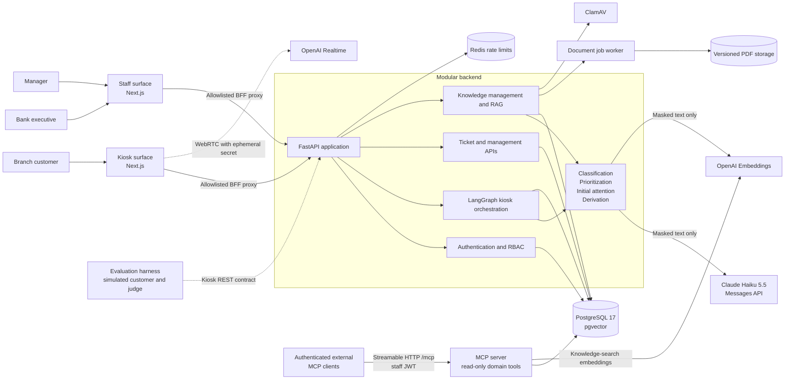
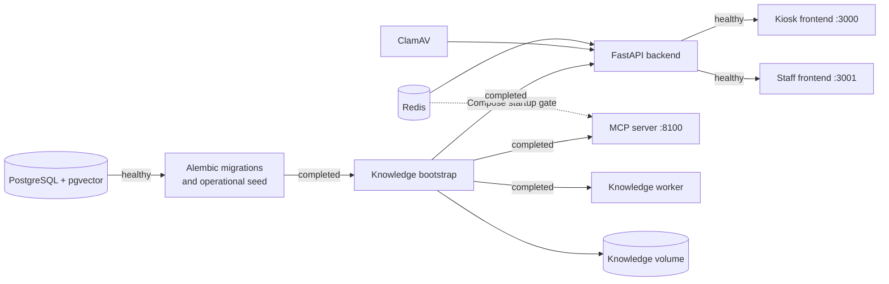

# Architecture



The MCP server is a second ASGI process on its own port, sharing the backend's domain
code and PostgreSQL database without becoming part of the kiosk request path. The kiosk,
staff surfaces, and the evaluation harness all reach the backend over REST; authenticated
external MCP clients use `/mcp` -- see [MCP server](mcp.md).

## Deployment topology

Docker Compose defines an ordered startup pipeline. Migrations and deterministic operational seeding complete before knowledge ingestion, the API, and both frontend surfaces become available.



## Backend modules

The backend is a modular monolith: deployment remains simple, while API, domain, persistence, orchestration, AI-provider, and knowledge responsibilities stay explicitly separated.

| Module | Responsibility |
| --- | --- |
| `app/api` | HTTP contracts, dependency injection, kiosk session authorization, staff RBAC, pagination, and filters. `tickets/` and `management/` are packages: routes, queries/filters and serializers/audit split apart |
| `app/services/orchestrator` | Thin adapter, in three modules: `service.py` (session locking and invoking the LangGraph graphs below), `responses.py` (shaping their final state into API responses), `speech.py` (every sentence the kiosk says, and the `SpeechPlan`s that carry them) |
| `app/services/graph` | The state machine itself -- turn/confirmation/identification graphs, the shared `finalize` subgraph, the auto-resolve branch, guard and idempotency logic (see [Orchestration policy](orchestration.md#orchestration-policy)) |
| `app/services/agents` | One module per agent -- `classification`, `prioritization`, `derivation`, `initial_attention` -- over `rules/`, the deterministic leaf modules holding the category keywords, the sensitivity floor and the naturalness checks |
| `app/services/prompts` | The model-facing text as policy in its own right: the voice persona, the consultation-level rules, the grounding rules |
| `app/services/anthropic_provider.py` | Transport only: structured Claude calls for classification, confirmation reading, and grounded generation |
| `app/services/openai_provider.py` | Transport only: embeddings and realtime client-secret creation |
| `app/services/pii.py` | Local PII detection and masking before downstream AI processing |
| `app/knowledge` | PDF extraction, chunking, ingestion, retrieval, grounding validation, evaluation, and management lifecycle; `uploads.py` holds the gate a PDF passes before it may become a document |
| `app/mcp_server` | Read-only MCP tools for authenticated external clients -- bearer-authenticated, streamable-HTTP, never called by the frontends (see [MCP server](mcp.md)) |
| `app/domain/schemas` | API and AI schemas grouped by the surface that exchanges them: `kiosk`, `staff`, `management`, `knowledge`, `auth`, `ai` |
| `app/db` | Async SQLAlchemy models split into their four bounded contexts (`identity`, `kiosk`, `operations`, `knowledge`), plus repositories, session management, and idempotent operational seeding |
| `alembic` | Explicit, ordered schema migrations including pgvector and the HNSW vector index |
| `scripts/` | Operational scripts: OpenAPI export, graph-diagram rendering, operational-document rendering, pre-eval queue reset, classifier stability probe |
| `evals/` (standalone project) | Scenario harness and LLM judge scoring policy compliance and service quality against a live backend; own venv, not part of the modular backend (see [Evaluation harness](evaluation.md)) |

## Technology stack

| Layer | Technologies |
| --- | --- |
| Frontend | Next.js 16, React 19, TypeScript, Tailwind CSS 4, Recharts, OpenAI Agents SDK, Zod |
| Backend | Python 3.12, FastAPI, Pydantic 2, SQLAlchemy 2 async, Uvicorn, Structlog |
| AI | Claude Haiku 5.5 (Messages API structured outputs) for orchestration decisions, OpenAI Realtime, OpenAI text embeddings, LangGraph on LangChain Core (kiosk state machine), MCP (external read-only domain tools), AutoGen (offline REST-based evaluation: simulated customer and LLM judge) |
| Data | PostgreSQL 17, pgvector, HNSW cosine index, Alembic |
| Security | Argon2, JWT access tokens, rotating opaque refresh tokens, HMAC identifier protection |
| Tooling | Docker Compose, `uv`, `pnpm`, Ruff, Pytest, Vitest, ESLint |

## Repository structure

```text
.
├── backend/
│   ├── alembic/                 # Versioned database migrations
│   ├── app/
│   │   ├── api/                 # FastAPI routers and access dependencies
│   │   ├── core/                # Configuration, errors, security, time helpers
│   │   ├── db/                  # Models, repositories, sessions, operational seed
│   │   ├── domain/              # Enums and Pydantic contracts
│   │   ├── knowledge/           # Ingestion, retrieval, RAG, document management
│   │   ├── mcp_server/          # Read-only MCP tools for authenticated external clients
│   │   └── services/            # Orchestrator adapter, LangGraph graphs, agents, PII, Anthropic and OpenAI providers
│   ├── evals/                   # Standalone evaluation harness + judge (own project, own venv)
│   ├── scripts/                 # OpenAPI export, graph diagrams, operational docs, eval queue reset
│   ├── seed/                    # Deterministic branch and executive catalog
│   └── tests/                   # Backend unit and integration suite
├── frontend/
│   ├── app/                     # Kiosk, executive, and management routes
│   ├── components/              # Product and UI components
│   ├── lib/                     # API client, realtime logic, domain types
│   └── tests/                   # Surface isolation and realtime behavior tests
├── doc/
│   ├── rag/                     # Governed source PDFs and manifest
│   └── operacion/               # Generated operational documentation
├── docker-compose.yml           # Complete local topology and startup ordering
└── .env.example                 # The single configuration template (backend, Compose, frontend)
```
