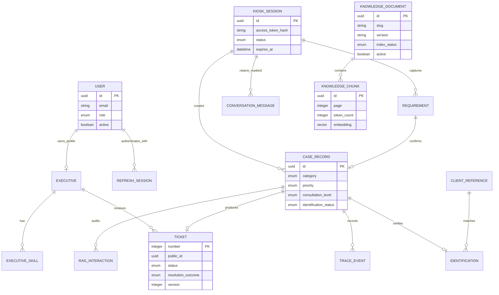

# Data model

## Migrations

Schema evolution is managed by explicit, frozen Alembic revisions in
`backend/alembic/versions/`. `Base.metadata.create_all()` is never used in migrations;
only the tests create an isolated ephemeral SQLite schema from the models.

- `20260716_0001`: operational schema;
- `20260716_0002`: pgvector, documents, chunks, and RAG interactions;
- `20260716_0003`: expiry, proposed priority, and document lifecycle;
- `20260717_0004`: customer registry, internal sources, and estimated wait;
- `20260720_0005`: natural flow, idempotent confirmation, and recoverable state;
- `20260721_0006`: operational case file, retained conversation, and structured closure;
- `20260728_0007`: document queue, management controls, and closure privacy;
- `20260813_0008`: historical revision kept for deployment compatibility;
- `20260813_0009`: permanent retirement of the historical document-proposal table;
- `20260818_0010`: drops the unique constraint on `cases.session_id`;
- `20260824_0011`: kiosk robustness hardening;
- `20260825_0012`: multi-need intake support;
- `20261019_0013`: `kiosk_sessions.decline_count`, so one declined turn no longer ends
  the session.

Upgrading to `0009` deletes any records that may exist in that table. Take a backup
before migrating if you need to keep them; a downgrade reconstructs only the empty
structure. New revisions must be exercised against local PostgreSQL
(`make services-up`), not only the SQLite test schema.

`20260818_0010` dropped the unique constraint on `cases.session_id`, which had made
"one case per kiosk session" a database fact rather than a policy choice -- it is why a
follow-up question after an automatic answer had no row to occupy and was rejected with a
`409`. `tickets.case_id` stays unique: one ticket per case is still correct, and a second
case brings its own ticket.
