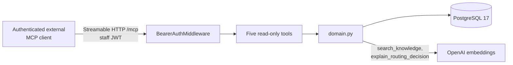

# MCP servers

This repository contains two MCP servers with nothing in common but the protocol. Keeping
them straight matters, because one is part of the product and the other exists only while a
test run is in flight.

| | `backend/app/mcp_server/` | `backend/evals/harness/mcp_kiosk_server.py` |
| --- | --- | --- |
| Purpose | Read-only domain access for external MCP clients | Lets a local `claude` / `codex` CLI drive a live kiosk session as the simulated customer |
| Tools | Five, all read-only | Three: `send_turn`, `send_confirmation`, `send_identification` -- the same bound methods the AutoGen customer agent calls |
| Process | Own ASGI application on port `8100` | In-process, ephemeral localhost port, pooled for the length of one eval run |
| Authentication | Staff JWT through `BearerAuthMiddleware` | None -- reachable only by the CLI subprocess the harness just spawned on the same machine |
| Ships to production | Yes | No; it lives in the standalone eval project |

The rest of this section is about the first one.

## Read-only domain tools (`app/mcp_server/`)

`app/mcp_server/` runs as a second ASGI application (`python -m app.mcp_server`, port
`8100`) using the backend image and domain code but a separate process and database
connection pool. It exposes five read-only tools over MCP's streamable-HTTP transport to
authenticated external MCP clients. The kiosk and staff frontends call the typed REST API,
and so does the [evaluation harness](evaluation.md), whose scenarios exercise that
same kiosk REST contract. The LangGraph nodes never call MCP.

| Tool | Returns |
| --- | --- |
| `search_knowledge` | pgvector evidence for a query, scoped to a category -- fragments with citation and similarity score, never a generated answer |
| `get_case_trace` | The auditable `TraceEvent` timeline for a case, PII-masked |
| `list_executive_availability` | Available executives, active workload, and category skills |
| `get_ticket_status` | Ticket status, priority, estimated wait, and assigned executive -- never the customer identifier |
| `explain_routing_decision` | Recomputes `DerivationAgent`'s full ranking (semantic match 70%, experience 20%, workload 10%) without mutating the case |



Authentication reuses the same JWT and role model as the staff REST API
(`decode_access_token`, `UserRole.EXECUTIVE` / `UserRole.MANAGER`) rather than a parallel
scheme. The check is inlined as raw ASGI middleware (`app/mcp_server/auth.py`) instead of
Starlette's `BaseHTTPMiddleware`, which buffers the response body and is unsafe for MCP's
streaming transport. The server never exposes kiosk-session mutation or identifier
reveal -- those operations stay exclusive to the authenticated REST API.

Run it locally alongside the backend:

```bash
cd backend
uv run python -m app.mcp_server
curl http://localhost:8100/healthz
```

After obtaining an executive or manager access token through the REST authentication
API, configure the MCP client to connect to `http://localhost:8100/mcp` with
`Authorization: Bearer <access-token>`.

## Eval kiosk bridge (`evals/harness/mcp_kiosk_server.py`)

The evaluation harness can put a local coding-agent CLI (`claude -p`, `codex exec`) in the
customer's seat instead of an OpenAI model. Neither CLI accepts caller-defined tools as a
request parameter the way the Chat Completions API does, but both run an agentic tool loop
against an MCP server, so the harness stands up its own: three tools --
`send_turn`, `send_confirmation`, `send_identification` -- wrapping the exact bound methods
the AutoGen customer agent already calls, with the same 12-call budget. `serve_kiosk_pool`
keeps a small pool of these servers alive for the whole run rather than rebuilding one per
scenario; `serve_kiosk_tools` binds a single server to a single session and is what the
harness's own tests exercise against a real MCP client.

It is localhost-only and unauthenticated by design: the only thing that can reach it is the
CLI subprocess the harness spawned seconds earlier on the same machine. It never runs outside
an eval run, and it is not part of the deployed system. See
[Running on a local CLI instead of OpenAI](evaluation.md#running-on-a-local-cli-instead-of-openai).
