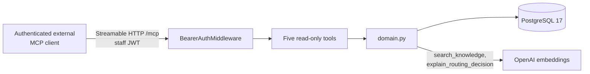

# MCP server

The backend ships one MCP server: read-only domain access for authenticated external MCP
clients. It is not on the kiosk request path.

## Read-only domain tools (`app/mcp_server/`)

`app/mcp_server/` runs as a second ASGI application (`python -m app.mcp_server`, port
`8100`) using the backend image and domain code but a separate process and database
connection pool. It exposes five read-only tools over MCP's streamable-HTTP transport to
authenticated external MCP clients. The kiosk and staff frontends call the typed REST API,
and so does the [evaluation harness](evaluation.md), whose scenarios exercise that
same kiosk REST contract. The LangGraph nodes never call MCP.

| Tool | Returns |
| --- | --- |
| `search_knowledge` | pgvector evidence for a query, scoped to a category -- fragments with citation and similarity score, never a generated answer |
| `get_case_trace` | The auditable `TraceEvent` timeline for a case, PII-masked |
| `list_executive_availability` | Available executives, active workload, and category skills |
| `get_ticket_status` | Ticket status, priority, estimated wait, and assigned executive -- never the customer identifier |
| `explain_routing_decision` | Recomputes `DerivationAgent`'s full ranking (semantic match 70%, experience 20%, workload 10%) without mutating the case |



Authentication reuses the same JWT and role model as the staff REST API
(`decode_access_token`, `UserRole.EXECUTIVE` / `UserRole.MANAGER`) rather than a parallel
scheme. The check is inlined as raw ASGI middleware (`app/mcp_server/auth.py`) instead of
Starlette's `BaseHTTPMiddleware`, which buffers the response body and is unsafe for MCP's
streaming transport. The server never exposes kiosk-session mutation or identifier
reveal -- those operations stay exclusive to the authenticated REST API.

Run it locally alongside the backend:

```bash
cd backend
uv run python -m app.mcp_server
curl http://localhost:8100/healthz
```

After obtaining an executive or manager access token through the REST authentication
API, configure the MCP client to connect to `http://localhost:8100/mcp` with
`Authorization: Bearer <access-token>`.
