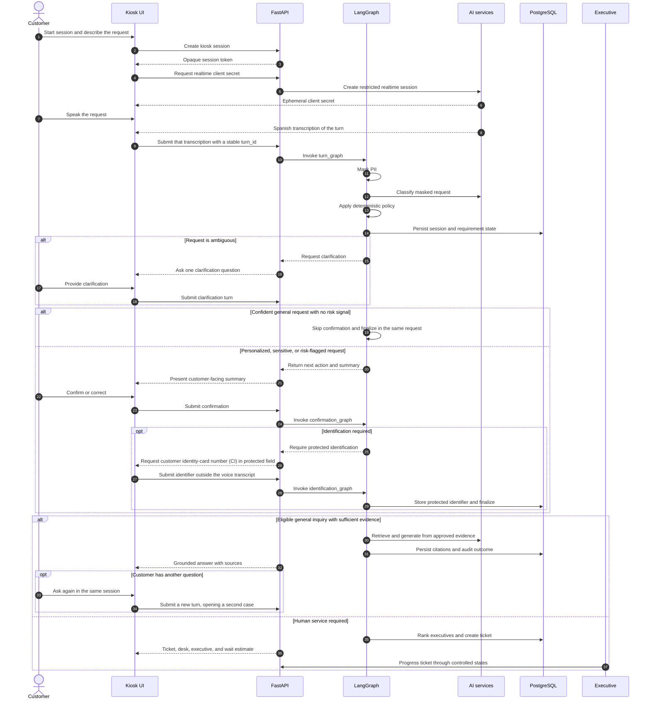
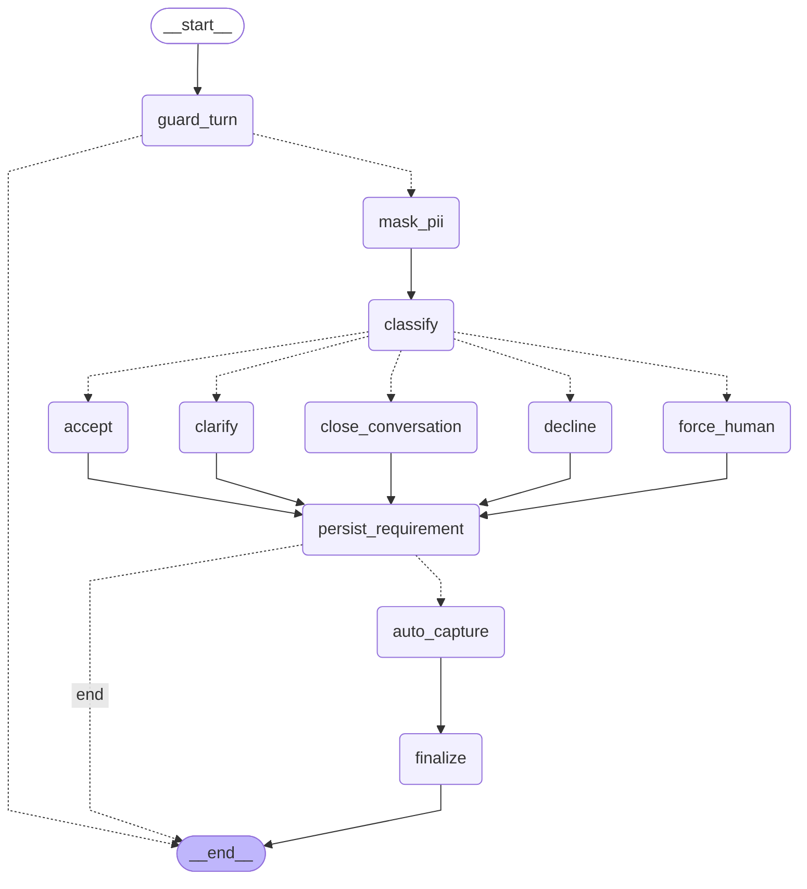
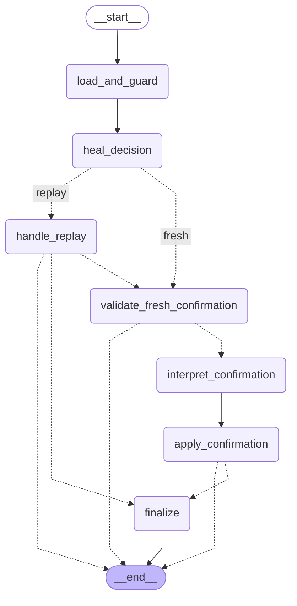
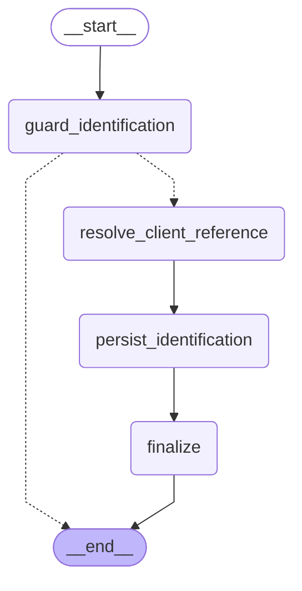
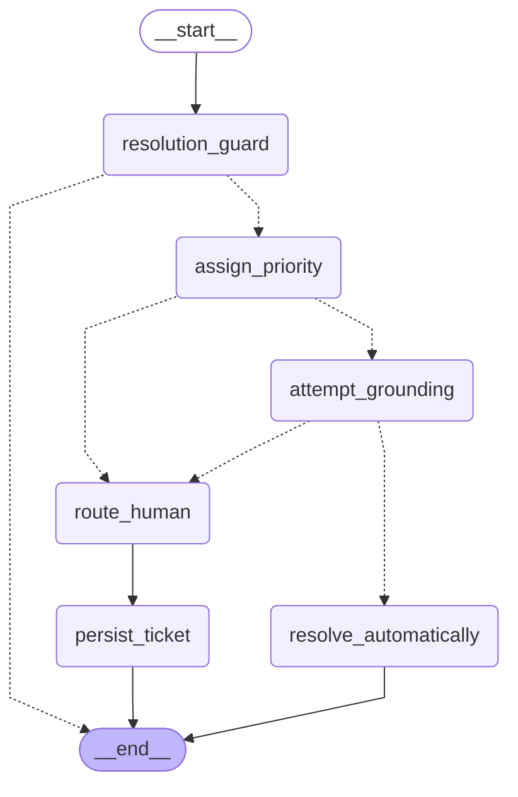

# Kiosk orchestration

## Customer journey

The backend owns the business state machine, and the browser owns the turn. The realtime session never answers by itself (`create_response` is off): when the customer stops talking and the session's Spanish transcription of what they said lands, the browser sends it — to analysis, to confirmation, or nowhere, from reconciled business state — and only then asks the model to speak, with that turn's outcome attached. The realtime agent has no tools. When it had one and decided by itself when to call it, a room full of people made it consult the bank before greeting anyone, preface every lookup with "déjame verificar", and read an internal "nothing to process" note aloud. A lone word such as "Quiero" waits a moment for the rest of the sentence; a turn with nothing to say gets no response at all; if the bank takes more than a second and a half, the kiosk says one fixed "Un momento, por favor". An out-of-scope turn is declined without ending the session — the kiosk names what it attends and keeps listening — unless it is the second in a row.

The division is between deciding and speaking. Every decision is the backend's: PII masking, classification, priority, the clarification budget, whether identification is required, what the evidence supports, which executive gets the case. Every sentence is the model's — it greets, asks, confirms, and explains, in its own words. A turn's outcome is not a line to read out; it is a `SpeechPlan` carrying the facts the backend decided, one line of guidance, and the strings that must survive word for word. Those strings are the ones that carry operational weight: an executive's name, the credential-entry warning, and the grounded answer, which is bound to its citations and is never re-composed. The client checks that they were actually spoken, on screen and in its logs — it never pushes a correction back into the conversation, because a mid-conversation "say this word for word" is a second response the customer hears as a stray fragment. Anything carrying a digit is stated but not measured: speech renders "Ventanilla 3" as "ventanilla tres", so the ticket number and the window travel as facts and the ticket screen stays the authoritative copy.

The model never carries the customer's words anywhere — the transcript comes from the voice session's own Spanish transcription, which is also what the captions show. The text that gets masked, classified, prioritized and routed is therefore the same text the customer sees on screen, with nothing for the model to retype or reinterpret. The browser restores retained masked messages after a reconnect and merges them by Realtime item ID instead of replacing the visible conversation.

The microphone is closed in exactly three places: while the customer types their identity-card number into the protected field, after a case has passed to a person, and after the second out-of-scope request in a row. Everywhere else — including the several seconds a classification or a retrieval takes — it stays live, so the customer can interrupt, correct, or add something mid-turn.

Only one thing speaks at a time. Every response — the greeting, a turn's outcome, the filler, a reconnect summary, the closing after the identity card is typed — goes through a single arbiter that holds it until the model has stopped talking, drops it if the business state has moved on by then, and cuts the current sentence off when it has been superseded, which is what a customer who finishes typing their identity-card number mid-instruction has done to it. The greeting goes out first and cannot be interrupted; whatever is said over it is answered as soon as it ends.



## Orchestration policy

The kiosk flow is implemented as three [LangGraph](https://github.com/langchain-ai/langgraph)
graphs (`app/services/graph/`), one per API entry point, sharing a compiled `finalize`
subgraph. The diagrams below are generated directly from the compiled graphs via
`graph.get_graph().draw_mermaid()` -- from `backend/`, run
`PYTHONPATH=. uv run python scripts/render_graph_diagrams.py` after any change to
`app/services/graph/*.py` to regenerate this section, so it cannot drift from the
implementation. Dashed edges are dynamic `Command`-based routing (guard and
replay-idempotency branches, e.g. an already-completed turn short-circuiting to its cached
result); solid edges are static and dashed-with-labels are conditional policy branches.

No LangGraph checkpointer is used: each HTTP request is already the unit of work, and
`SessionStatus` on the `kiosk_sessions` row -- read under `SELECT ... FOR UPDATE` on
PostgreSQL -- is the durable, queryable record of where a session is in the flow. See the
module docstring in `app/services/graph/state.py` for the full reasoning.

The application imports LangGraph directly. LangChain Core provides the underlying graph
runtime abstractions through LangGraph's dependency tree; there is no separate LangChain
agent layer in the kiosk.

### When the kiosk answers without asking

`turn_nodes.requires_confirmation` decides whether a turn stops at `AWAITING_CONFIRMATION`
or resolves inside the same HTTP request. Confirmation is friction that only earns its keep
when something irreversible follows -- identification, or a human handoff -- and `GENERAL`
is exactly the consultation level that needs neither: its case is always `ANONIMO`, and it
is the only level `InitialAttentionAgent` will ground at all. A confident `GENERAL`
classification therefore skips the round-trip and `turn_graph` reaches the shared `finalize`
subgraph itself, through `accept -> persist_requirement -> auto_capture`. The turn responds
`next_action: COMPLETE` carrying the full result -- answer and citations, or ticket, desk and
wait estimate -- instead of a summary to confirm.

Two independent signals have to agree before a session resolves itself that way. The eval
run of 2026-08-18 has the classifier returning `GENERAL` at 0.99 confidence for *"me robaron
mi tarjeta de debito"* while its own `security_incident` and `distress_detected` flags said
the opposite, so either risk flag -- or a `REPORTE_FRAUDE` category -- forces the
confirmation step whatever the level says. `backend/scripts/probe_classifier.py` replays
recorded openers through the classifier to measure how often a label actually flips, rather
than inferring stability from a single eval run.

### Deterministic floors over the classifier

`agents.sensitivity_floor()` derives, from the masked text alone, the lowest consultation
level a request may be treated as: a fraud report, an incident that has already happened
("me robaron", "no reconozco"), the customer's own banking objects, or their own file and
access. `ClassificationAgent._enforce_sensitivity` applies it as a floor that only ever
*raises* the model's answer -- the classification source becomes `MODEL+FLOOR` -- and never
lowers it. Over-classification costs one confirmation turn; under-classification costs
identification and human escalation outright. The keyword tables are shared with the offline
fallback, so a floor and the fallback it mirrors cannot drift apart.

Both loop counters are bounded, and neither ends in a dead session. When the clarification
budget (`MAX_CLARIFICATIONS`) runs out, `force_human` drops the level to `GENERAL` -- asking
for an identity card for a request nobody understood is the over-identification the policy
forbids -- but keeps the *category*, which is what `PrioritizationAgent` and `DerivationAgent`
read. When the correction budget (`MAX_CORRECTIONS`, default 2) runs out, the requirement is
marked `force_human`, a `CORRECTION_LIMIT_REACHED` trace event is recorded, and the case goes
straight to an executive with what was understood so far.

### Graphs

<!-- BEGIN GENERATED GRAPH DIAGRAMS -->

#### `turn_graph`

Handles `POST /kiosk/sessions/{id}/turns`. `finalize` is the shared subgraph below: a confident GENERAL classification reaches it through `auto_capture` without a confirmation round-trip (see `turn_nodes.requires_confirmation`).



#### `confirmation_graph`

Handles `POST /kiosk/sessions/{id}/confirmation`. `finalize` is the same compiled subgraph `turn_graph` and `identification_graph` use.



#### `identification_graph`

Handles `POST /kiosk/sessions/{id}/identification`.



#### `finalize_subgraph`

Compiled once in `builder.py` and added as the `finalize` node to all three graphs above -- the same compiled instance, not a copy.


<!-- END GENERATED GRAPH DIAGRAMS -->

## Agents and their decision boundaries

| Component | Decision boundary |
| --- | --- |
| `ClassificationAgent` | Produces a validated structured category, consultation level, confidence, ambiguity status, customer-facing summary, and risk signals. A deterministic floor may raise the consultation level it returned, never lower it; a conservative local keyword fallback covers a provider outage. |
| `PrioritizationAgent` | Assigns `BAJO`, `MEDIO`, `ALTO`, or `CRITICO` through deterministic banking rules; preferential attention can raise non-high priorities by one level. |
| `InitialAttentionAgent` | Allows automatic answers only for `GENERAL` requests and only when `KnowledgeService` returns a grounded, naturally worded response. |
| `DerivationAgent` | Filters to available executives with the required category, then ranks by semantic match (70%), experience (20%), and workload (10%). |

Concurrency-sensitive kiosk operations lock the session row on PostgreSQL. Stable `turn_id` values, unique database constraints, recorded confirmation decisions, and one-ticket-per-case constraints make client retries safe. Ticket updates use an `expected_version` field and a closed transition graph:

```text
PENDIENTE -> EN_ATENCION -> CERRADO
```

## Kiosk API sequence

`app/services/orchestrator/` is a thin adapter over the three graphs; `api/kiosk.py` is the
only HTTP entry point into them.

1. `POST /api/v1/kiosk/sessions` creates a short-lived session with an opaque token.
2. Subsequent calls use `X-Session-Token`.
3. `POST .../realtime-token` creates an ephemeral secret for WebRTC. The regular API
   key never leaves the backend.
4. `POST .../turns` masks PII and classifies. `turn_id` makes the operation idempotent.
5. The flow responds `CLARIFY`, `CONFIRM`, `DECLINE`, or `COMPLETE`. `COMPLETE` means a
   confident `GENERAL` request skipped confirmation and finalized inside the same request,
   with the answer or human-handoff ticket already in `result`. Grounded answers never
   allocate queue tickets. A `DECLINE` carries `conversation_can_continue`: one
   out-of-scope turn keeps the session listening; a second in a row ends it.
6. `POST .../confirmation` allows correction or starts finalization, where priority is
   applied and the case is created. Rejecting the summary `MAX_CORRECTIONS` times (default
   2) records a `CORRECTION_LIMIT_REACHED` trace event and derives the case to an executive
   instead of asking again.
7. The `PERSONALIZADA` and `SENSIBLE` levels request the customer's CI through a
   protected field (`POST .../identification`), outside the voice transcript.
8. `GENERAL` inquiries attempt RAG; any evidence gap routes to a person.
9. A further question after an automatic answer reopens the session
   (`RESOLVED_AUTOMATIC` -> `LISTENING`, per-need counters reset) and produces a second
   auditable case without a ticket. `ASSIGNED` sessions are excluded -- an executive
   already holds that case. A turn that only ends the conversation ("ya está, gracias,
   eso era todo"), classified `closing_turn` with no other need, opens nothing: the
   session stays `RESOLVED_AUTOMATIC`, the response is `COMPLETE` with a `FAREWELL` speech
   plan and `conversation_can_continue=false`, and the requirement is stored inactive with
   `classification_source="CLOSING"` for idempotency and audit. It is honoured only after
   the kiosk has answered something in the session.

The realtime agent has no tools; the browser decides where each transcribed turn goes
(analysis, confirmation, or nowhere) from reconciled business state, and RAG,
identification, and ticket creation stay behind the REST API. See
[Frontend](frontend.md#kiosk-turn-handling) for the client side.
