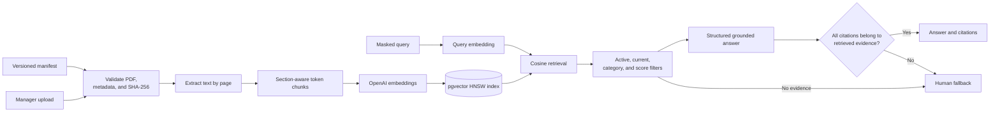

# Retrieval-augmented generation

The knowledge subsystem is governed rather than open-ended. It indexes only registered PDF documents and refuses to answer when retrieval or citation validation fails.



An automatic response requires all of the following:

1. The request is classified as a general consultation and is not marked for forced human handling.
2. The query has already been masked.
3. Retrieved documents are active, within their review period, category-compatible, and above the configured similarity threshold.
4. The prompt context stays within the configured token budget.
5. The model returns a supported structured response with at least one citation.
6. Every cited chunk belongs to the exact retrieved evidence set.

Every retrieval attempt records its outcome, prompt version, retrieved chunk metadata, and an answer hash when applicable. The raw generated answer is not duplicated in the RAG audit record.

The corpus itself is eight manifest-managed PDFs (`doc/rag/`), currently at version
`2026.08.2` -- regenerated in August 2026 with the sections the eval runs showed missing
(agency hours, accounts for minors, periodic-payment deposits, among others), each with a
fresh `sha256`, `verified_at`, and `review_after` date that the ingestion CLI verifies before
indexing.

Managers can list, upload, update, version, download, reindex, and archive knowledge documents. Upload validation covers PDF signature, MIME type, file size, page count, extractable text, category metadata, and HTTP(S) source URLs; stored objects use generated UUID keys instead of user-supplied filenames.

## Knowledge base CLI and worker

Bootstrap consumes exclusively `doc/rag/manifest.json`; documents are never generated at
runtime. The managed PDFs and the manifest are themselves generated: after changing their
sources run `cd backend && uv run python scripts/render_operational_documents.py`.

From `backend/`:

```bash
uv run python -m app.knowledge.cli ingest
uv run python -m app.knowledge.cli status
uv run python -m app.knowledge.cli evaluate
```

`ingest` validates the manifest and content hashes, extracts and chunks PDFs, creates embeddings, updates document versions, and backfills executive-skill embeddings. `status` reports active documents and chunks. `evaluate` runs retrieval cases and verifies that policy-ineligible requests are not answered automatically.

The management API under `/api/v1/management/knowledge/documents` queues indexing jobs;
`python -m app.knowledge.worker` claims them with locking, retries recoverable failures,
and keeps the previously active document when a reindex fails. ClamAV scans every upload
before storage. The upload gate lives in `app/knowledge/uploads.py`.
